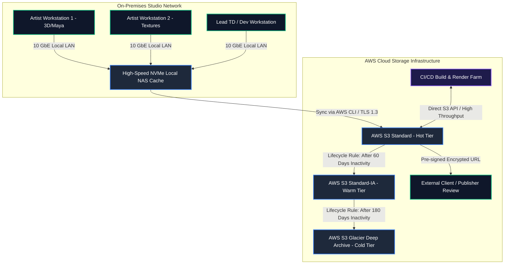

# Cloud Storage Architecture Diagram & Infrastructure Specification

**Subject:** Tools & Techniques of Game and VFX-II (BCA MIT)  
**Author:** Mehak Joon  
**Deliverable:** Item 4 - Cloud Storage Architecture  

---

## 1. High-Level Architecture Overview

In a Game and VFX production pipeline, digital assets vary drastically in size, access frequency, and latency requirements. Storing everything on expensive high-performance SSD cloud storage wastes budget, while keeping everything on cold tape/glacier storage halts daily artist workflows.

We design a **Hybrid Multi-Tier Cloud Storage Topology** leveraging local edge caching and automated AWS S3 object lifecycle transitions:



---

## 2. Textual / ASCII Topology Diagram

For inclusion in non-graphical printouts or academic text submissions:

```
+-------------------------------------------------------------------------------+
|                       STUDIO LOCAL NETWORK (ON-PREMISES)                      |
|                                                                               |
|  [3D Workstations]          [Texture Workstations]       [VFX Simulation Node]|
|          │                            │                            │          |
|          └──────────────────────┬─────┴────────────────────────────┘          |
|                                 ▼ (10 GbE Internal LAN)                       |
|                 +──────────────────────────────────────+                      |
|                 |    Studio Edge NAS (Local Cache)     |                      |
|                 |  100 TB High-Speed ZFS NVMe Pool     |                      |
|                 +──────────────────────────────────────+                      |
+------------------------------------│------------------------------------------+
                                     │ (Automated Sync via TLS 1.3 / AWS S3 CLI)
                                     ▼
+-------------------------------------------------------------------------------+
|                           AWS CLOUD STORAGE FABRIC                            |
|                                                                               |
|  +─────────────────────────────────────────────────────────────────────────+  |
|  | TIER 1: AWS S3 STANDARD (HOT TIER)                                      |  |
|  | - Daily active working assets, uncompressed textures, sound masters     |  |
|  | - Build artifacts for CI/CD, game engine imports                        |  |
|  | - Latency: Milliseconds | Availability: 99.99%                         |  |
|  +─────────────────────────────────────────────────────────────────────────+  |
|                                     │                                         |
|                                     │ (Lifecycle Transition: 60 Days Idle)    |
|                                     ▼                                         |
|  +─────────────────────────────────────────────────────────────────────────+  |
|  | TIER 2: AWS S3 STANDARD-INFREQUENT ACCESS (WARM TIER)                  |  |
|  | - Milestone builds (Alpha, Beta), completed sprint footage              |  |
|  | - Latency: Milliseconds | Cost: ~50% savings compared to Standard      |  |
|  +─────────────────────────────────────────────────────────────────────────+  |
|                                     │                                         |
|                                     │ (Lifecycle Transition: 180 Days Idle)   |
|                                     ▼                                         |
|  +─────────────────────────────────────────────────────────────────────────+  |
|  | TIER 3: AWS S3 GLACIER DEEP ARCHIVE (COLD TIER)                         |  |
|  | - Raw camera footage, simulation point caches (.vdb), gold masters      |  |
|  | - Latency: 3 to 12 Hours | Cost: $0.00099 / GB / Month (~95% savings)  |  |
|  +─────────────────────────────────────────────────────────────────────────+  |
+-------------------------------------------------------------------------------+
```

---

## 3. Storage Tier Specifications

| Parameter | Tier 1: S3 Standard (Hot) | Tier 2: S3 Standard-IA (Warm) | Tier 3: Glacier Deep Archive (Cold) |
| :--- | :--- | :--- | :--- |
| **Typical Data Types** | Active `.fbx`, `.blend`, 4K `.png`, `.wav` | Milestone builds, archived sprint renders | Raw footage, `.vdb` smoke caches, final release gold |
| **Access Latency** | Milliseconds | Milliseconds | 3–5 hours (Standard) / 12 hours (Bulk) |
| **Durability** | 99.999999999% (11 9s) | 99.999999999% (11 9s) | 99.999999999% (11 9s) |
| **Storage Cost (us-east-1)**| ~$0.023 per GB/mo | ~$0.0125 per GB/mo | ~$0.00099 per GB/mo |
| **Retrieval Fee** | None | $0.01 per GB | $0.005 per GB (on restoration) |

---

## 4. Secure Sharing & Access Control Architecture

1. **Pre-Signed URLs for External Reviews:**
   * Directors, clients, or audio contractors receive temporary pre-signed HTTPS links valid for **15–60 minutes**. No AWS account or permanent IAM credentials required.
2. **KMS Server-Side Encryption (SSE-KMS):**
   * All assets stored at rest are encrypted using customer-managed cryptographic keys (`aws:kms:arn:...`).
3. **IAM Least-Privilege Policy Example:**
   ```json
   {
     "Version": "2012-10-17",
     "Statement": [
       {
         "Effect": "Allow",
         "Action": ["s3:GetObject", "s3:PutObject"],
         "Resource": "arn:aws:s3:::studio-media-assets/active/*"
       },
       {
         "Effect": "Deny",
         "Action": ["s3:DeleteObject"],
         "Resource": "arn:aws:s3:::studio-media-assets/*"
       }
     ]
   }
   ```
   *Artists can push and pull assets, but accidental or malicious deletion is strictly prevented by policy.*
