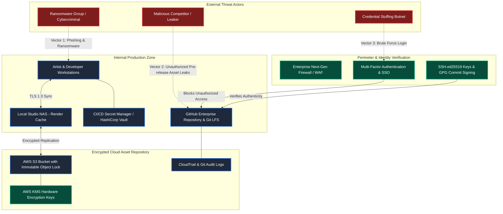

# Threat Model Diagram & Security Analysis

**Subject:** Tools & Techniques of Game and VFX-II (BCA MIT)  
**Author:** Mehak Joon  
**Deliverable:** Item 5 - Threat Model & Media Cybersecurity  

---

## 1. Media Production Pipeline Threat Model Diagram

Modern game studios and VFX facilities operate complex hybrid environments spanning remote artist workstations, on-premises render clusters, and cloud storage repositories. The diagram below maps the attack surfaces, threat vectors, and defensive barriers using the **STRIDE** methodology.



---

## 2. Textual / ASCII Security Flow Diagram

```
[ EXTERNAL ADVERSARIES ]
   │  • Ransomware Operators
   │  • Leakers / Social Engineers
   │  • Credential Stuffing Bots
   │
   ▼
[ LAYER 1: IDENTITY & PERIMETER ENFORCEMENT ]
   ├── FIDO2 Hardware Keys / TOTP Multi-Factor Authentication
   ├── Mandatory SSH-ed25519 & GPG Signed Commits
   └── GitHub Secret Scanning & Push Protection (Pre-commit)
   │
   ▼
[ LAYER 2: COLLABORATIVE REPOSITORY & LFS STORAGE ]
   ├── RBAC Least-Privilege Access (Admin / Maintainer / Contributor / Triage)
   ├── Branch Protection: Require 2 PR Approvals & Passing CI Tests
   └── Git LFS Pointers (Binaries stored in isolated cloud store)
   │
   ▼
[ LAYER 3: ASSET PACKAGING & DATA STORAGE ]
   ├── AES-256 KMS Server-Side Encryption at Rest
   ├── S3 Object Lock (Immutable WORM storage preventing ransomware deletion)
   └── Forensic & Visible Digital Watermarking on review media
```

---

## 3. STRIDE Threat Analysis Matrix

| Threat Category | Potential Attack Scenario in Game/VFX Studio | Implemented Defensive Control |
| :--- | :--- | :--- |
| **Spoofing Identity** | An adversary uses stolen developer credentials to commit backdoored shaders or malicious Python pipeline tools. | **Enforced MFA + GPG Signed Commits:** GitHub rejects unsigned commits or logins lacking TOTP/Hardware token confirmation. |
| **Tampering with Data** | A disgruntled contractor modifies 3D models or injects subtle normal map corruptions into master branches. | **Branch Protection Rules:** Direct commits to `main` and `development` are blocked. Requires mandatory peer review approval before merging. |
| **Repudiation** | An artist leaks confidential character designs to social media and claims someone else committed the asset. | **Cryptographic Git Audit Logs & Watermarking:** Forensic digital watermarks embed workstation identifiers into textures; Git commit hashes trace exact origin. |
| **Information Disclosure** | An unreleased game build or cinematic sequence is intercepted during transit between studio and client. | **End-to-End Encryption:** TLS 1.3 in transit; AES-256 at rest; short-lived (15-min) S3 pre-signed URLs with restricted IP binding. |
| **Denial of Service (DoS)** | Ransomware targets the local studio NAS, encrypting render caches and project files to extort the studio. | **Immutable S3 Object Lock & 3-2-1 Offsite Backups:** Cloud backups use Write-Once-Read-Many (WORM) storage that cannot be deleted or overwritten by ransomware. |
| **Elevation of Privilege** | A junior 3D modeler gains repository administrative privileges and modifies branch rules. | **Strict RBAC Hierarchy:** Access assigned via GitHub Organization Teams with minimum necessary scopes (`read`, `triage`, `write`, `admin`). |

---

## 4. Top 3 Cyber Attacks Targeting Media Studios & Mitigations

### 1. Ransomware and Extortion (e.g., Insomniac / Capcom breaches)
* **The Attack:** Attackers compromise an unpatched VPN endpoint, exfiltrate pre-release game builds, and encrypt local storage.
* **Studio Mitigation:** Implement network micro-segmentation, disable SMBv1 file shares, enforce Zero Trust Network Access (ZTNA), and utilize immutable cloud backup vaults.

### 2. Supply-Chain Dependency Poisoning
* **The Attack:** Attackers publish a malicious package with the same name as an internal pipeline library on public Python PyPI or npm.
* **Studio Mitigation:** Maintain a private pip/npm artifact proxy (e.g., Nexus or Artifactory), lock checksum hashes in lockfiles, and enable GitHub Dependabot vulnerability scanning.

### 3. Pre-Release Asset Leaks via Third-Party Contractors
* **The Attack:** Freelance voice actors or external VFX artists leak screener clips or unfinished renders.
* **Studio Mitigation:** Deploy individualized dynamic visual watermarking (burning the contractor's name and IP address across the frame) and embed invisible forensic metadata.
